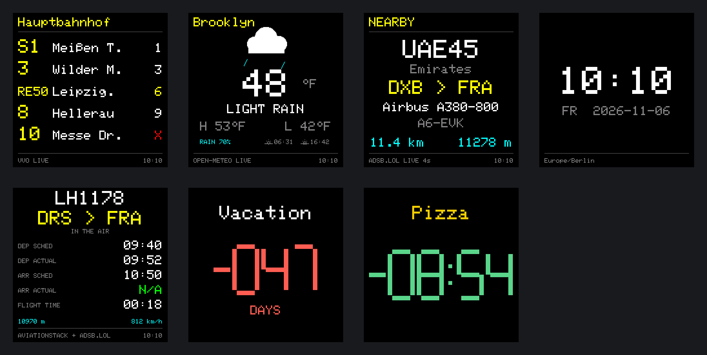
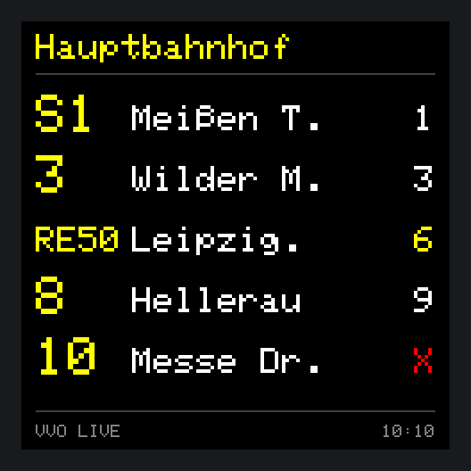
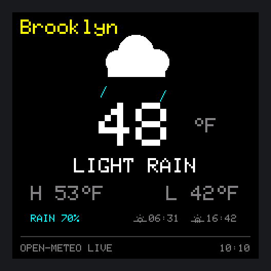
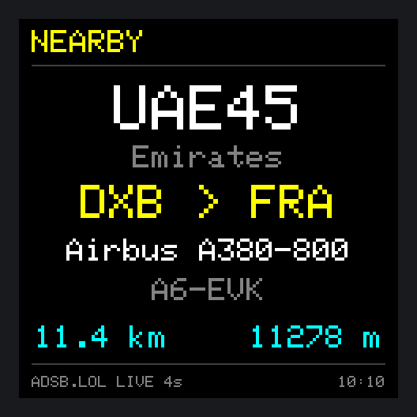
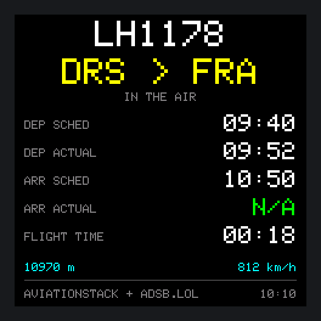
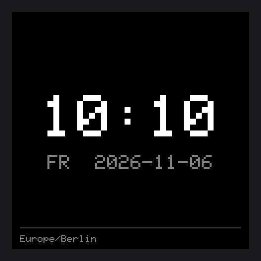
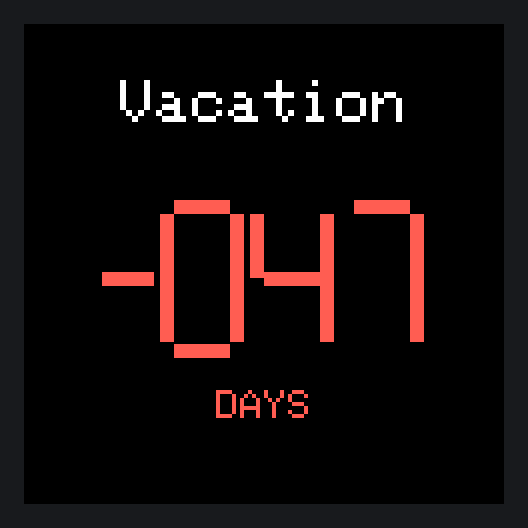

# 🚏 PixelStop

<a href="README.md"><b>← Deutsche Version</b></a>

**Departures, weather, flight radar, clock and countdowns for the GeekMagic SmallTV-Ultra.**
Bought as a small Wi-Fi cube with a rather modest stock firmware – and from day one with the plan to turn it into something of my own.

[](https://github.com/du13500/pixelstop/actions/workflows/build.yml)


<p align="center"></p>
<p align="center"><sub>All images are real firmware output with sample data, generated by <code>tools/render_screens.py</code>.</sub></p>

## What is PixelStop?

PixelStop is a custom firmware in German and English for the **GeekMagic SmallTV-Ultra**, a 240 × 240 pixel cube with an ESP8266. Once set up it only needs USB power and Wi-Fi – **no server, no Raspberry Pi**. Everything is configured in a web interface in your browser.

The cube shows, in rotation or permanently:

| View | What you see |
| --- | --- |
| **Departures** | Live departures of a stop of Verkehrsverbund Oberelbe (VVO, Dresden region): line, destination, minutes, delays and cancellations; up to ten departures on two pages, filter by mode of transport |
| **Weather** | Current temperature, day/night weather icon, high and low, chance of rain, sunrise and sunset; °C or °F |
| **Flight radar** | The nearest aircraft within the chosen radius: callsign, airline, route, type, registration, distance and altitude |
| **Clock** | Time and date with a selectable time zone |
| **Flight tracker** | One specific flight with scheduled and actual times and live altitude (your own aviationstack key required) |
| **Countdown 1–4** | Four independent timers with their own title and colours – in days, hours or minutes |

Plus night mode, brightness down to 1 %, place search with a map, Greek and Cyrillic characters, and a diagnostics view.

## Gallery

| | | |
| :---: | :---: | :---: |
| <br><sub><b>Departures</b> · Dresden Hauptbahnhof with a delay (yellow) and a cancellation (✕)</sub> | <br><sub><b>Weather</b> · Brooklyn in °F</sub> | <br><sub><b>Flight radar</b> · Emirates A380 from Dubai to Frankfurt</sub> |
| <br><sub><b>Flight tracker</b> · one flight with scheduled and actual times</sub> | <br><sub><b>Clock</b> · with time zone</sub> | <br><sub><b>Countdown</b> · in days or as a timer</sub> |

## Status: v0.5.0-dev

| Area | Status |
| --- | --- |
| Departures (VVO), weather, clock, countdowns | ✅ stable in daily use |
| Flight radar over HTTP/1.1, pauses on rejected requests | ✅ confirmed on hardware (v0.4.14.7) |
| Radar only while visible, daily budget without a key | ✅ running on hardware (v0.4.14.8), long-term observation ongoing |
| Backlight at 1 % without flashes | ✅ much improved (v0.4.14.6) |
| German/English language switch | ⏳ hardware test pending |
| Abbreviated destinations, omitting the town name | ⏳ hardware test pending |
| Flight tracker with your own aviationstack key | ⏳ not fully tested on hardware |

All changes are listed in [`CHANGELOG.md`](CHANGELOG.md) (German), open checks in [`ROADMAP.md`](ROADMAP.md).

## How it works

```
  Browser (phone/PC)                     PixelStop cube (ESP8266)
 ┌──────────────────────┐  Wi-Fi   ┌──────────────────────────────────┐
 │ Web interface        │◀────────▶│ Web server · settings            │
 │ Place search + map ──┼─▶ OSM    │ Requests: VVO ───── departures   │
 └──────────────────────┘          │           Open-Meteo  weather    │
                                   │           adsb.lol ── radar      │
                                   │           aviationstack tracker  │
                                   │ Display 240 × 240 (ST7789)       │
                                   └──────────────────────────────────┘
```

The cube queries the services itself and draws the views directly. Place search runs in the browser so that the ESP8266's scarce memory stays free. The flight radar only polls while it is on screen (plus shortly before it appears) and budgets adsb.lol's daily quota by itself when no key is set.

## Supported device

**GeekMagic SmallTV-Ultra with ESP8266 / ESP-12F, 4 MB flash and ST7789 display (240 × 240).** Other SmallTV models are untested. The firmware is not meant for ESP32 devices.

## Installation and setup

1. Flash the firmware onto the SmallTV-Ultra. The first flashing method depends on the installed firmware; the USB power port alone is not a guaranteed programming interface.
2. On first start, join the Wi-Fi **PixelStop-Setup** and open **192.168.4.1** in your browser.
3. Under **System**, pick your Wi-Fi, enter the password and save.
4. After the restart, open the web interface via the IP address on the display, or via `pixelstop.local` depending on your network.
5. Under **System → Sprache / Language**, choose English.
6. Under **Display**, set views, rotation times, time zone, brightness and night mode, then the stop, places and timers in their tabs.

> **Note:** Weather and flight radar have independent locations (place search, map or coordinates). An optional display name replaces the place name on screen. An empty Wi-Fi password field keeps the stored password.

**Updates** go through **System → Firmware update** with the matching `.bin`. Settings are kept.

## Building the firmware

The workflow [`build.yml`](.github/workflows/build.yml) builds the firmware on every push and pull request; the result is available under **Actions** as the artifact `pixelstop-v<version>-firmware`. A tag such as `v0.5.0` (matching `FW_VERSION` in [`src/Version.h`](src/Version.h)) also creates a **GitHub release** with the BIN file, checksum and companion package. Locally, `pio run -e smalltv_ultra` is enough.

The screenshots in this README are produced from the real display code by `python3 tools/render_screens.py docs/screens --frame --sheet`.

## Data sources and limits

| Service | Used for | Note |
| --- | --- | --- |
| **VVO** | Departures | Dresden / Upper Elbe region |
| **Open-Meteo** | Weather | free API for non-commercial use |
| **adsb.lol** | Radar positions, routes | limited requests per day and connection without a key; key optional |
| **adsbdb** | Airline, aircraft type, routes | separate reuse terms for route data |
| **aviationstack** | Flight tracker | your own key, plan limits |
| **OpenStreetMap / Nominatim** | Map, place names | manual search only, via the browser |

Radar routes come from additional databases and can be wrong or incomplete despite a position check; unsuitable routes are not replaced by guessed airports. `N/A` means missing data, `GND` an aircraft explicitly reported on the ground. Altitudes are flight altitudes, not height above ground. More in [`THIRD_PARTY_SERVICES.md`](THIRD_PARTY_SERVICES.md).

| Radar footer | Meaning |
| --- | --- |
| `ADSB.LOL LIVE 4s` | last successful update 4 seconds ago |
| `LAST DATA 16s` | update failed, previous data is shown for a short while |
| `PAUSED 46s` | adsb.lol asks for a pause; age of the last update |
| `NO AIRCRAFT` | request succeeded, but nothing within the radius |
| `ADSB.LOL / Access denied` | adsb.lol rejects requests (401/403/426); long pause instead of constant retries |

## Plans

- **More regions:** departures not only from VVO but selectable per transport association or Germany-wide (planned for v0.6.0).
- **Custom destination replacements** in the web interface.
- English diagnostics texts.

## Diagnostics and bug reports

Under **System → Diagnostics**, **Load log** shows the latest events. After a glitch, load the log right away; after a restart only the reset reason and the last marker remain. Helpful for bug reports: firmware version, affected view, steps to reproduce and a photo. Please **never publish Wi-Fi passwords or API keys**.

## Credits and license

- Own project code and documentation: **MIT**, Copyright (c) 2026 du13500. Keep the copyright and license notice when redistributing.
- Hardware and display basis from [smalltv-mod](https://github.com/giovi321/smalltv-mod) by giovi321 (WTFPL); the original notice is included.
- Libraries and their licenses: see [`THIRD_PARTY_NOTICES.md`](THIRD_PARTY_NOTICES.md) and [`LICENSES/`](LICENSES).
- Language flag: [English_language.svg](https://commons.wikimedia.org/wiki/File:English_language.svg) by Rei-artur and Kjoonlee, Wikimedia Commons, public domain.
- Map data © OpenStreetMap contributors.

---

**Know before you go. 🚏**

<sub>PixelStop is an independent hobby project and is not affiliated with GeekMagic, VVO or any of the data providers named above.</sub>
